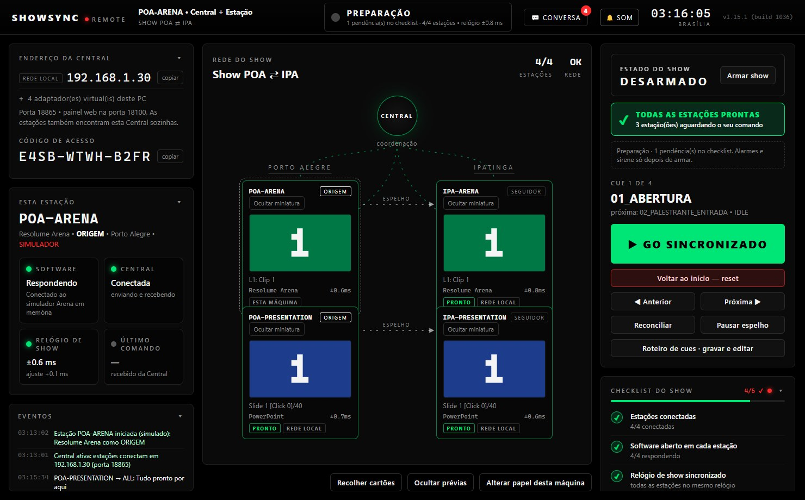

# ShowSyncRemote

Sincronização e supervisão de shows ao vivo entre cidades: a máquina **Origem** comanda e as
máquinas **Seguidoras** repetem, com confirmação de cada comando. Funciona com **Resolume Arena**,
**PowerPoint**, **PDF-to-PPT** e **Adobe Reader/Acrobat**, pela rede local ou pela **ZeroTier**. Na estação de
Conteúdos, até as teclas que o operador aperta se repetem nos Seguidores.



Site oficial, tutoriais e vídeos: **https://showsync.pages.dev**

> Este repositório guarda só os **downloads** (espelho do site). O código-fonte não é público.

## Baixar

Abra a [release mais recente](../../releases/latest) e escolha um dos arquivos:

| Arquivo | Para quem |
| :--- | :--- |
| `ShowSyncRemote_vX.Y.Z__build_NNNN_Setup.exe` | **Recomendado.** Instala no Windows, com atalho no menu Iniciar. |
| `ShowSyncRemote_vX.Y.Z__build_NNNN.exe` | Executável único, sem instalação. |
| `ShowSyncRemote_vX.Y.Z__build_NNNN_portable.zip` | Versão portátil: descompacte e rode de uma pasta ou pendrive. |

São **os mesmos arquivos** do site, com o mesmo SHA-256 (está na descrição de cada release).
Use o GitHub quando o download pelo site estiver lento ou bloqueado na sua rede.

**Use a mesma versão em todas as máquinas do show.** O aplicativo avisa quando sai uma versão
nova (ele consulta o site oficial; nada é baixado nem instalado sozinho).

## Requisitos

- Windows 10 ou 11, 64 bits
- Microsoft Edge WebView2 (já vem no Windows 11 e na maioria dos Windows 10 atualizados)

## Conferir o arquivo baixado

No PowerShell, na pasta do download:

```powershell
Get-FileHash .\ShowSyncRemote_v1.20.0__build_1050_Setup.exe
```

O resultado tem que ser igual ao SHA-256 publicado na release e no site.

## Assinatura e antivírus

Os pacotes são assinados por **Mizin Produções Audiovisuais** com certificado **autoassinado**.
Isso não dá confiança pública automática no Windows: o SmartScreen pode avisar na primeira
execução. **Não desative o antivírus.** Se houver detecção de ameaça, interrompa a execução e
informe o diagnóstico.

## Contato

Mizin Produções Audiovisuais · https://showsync.pages.dev

Software proprietário. Todos os direitos reservados.
